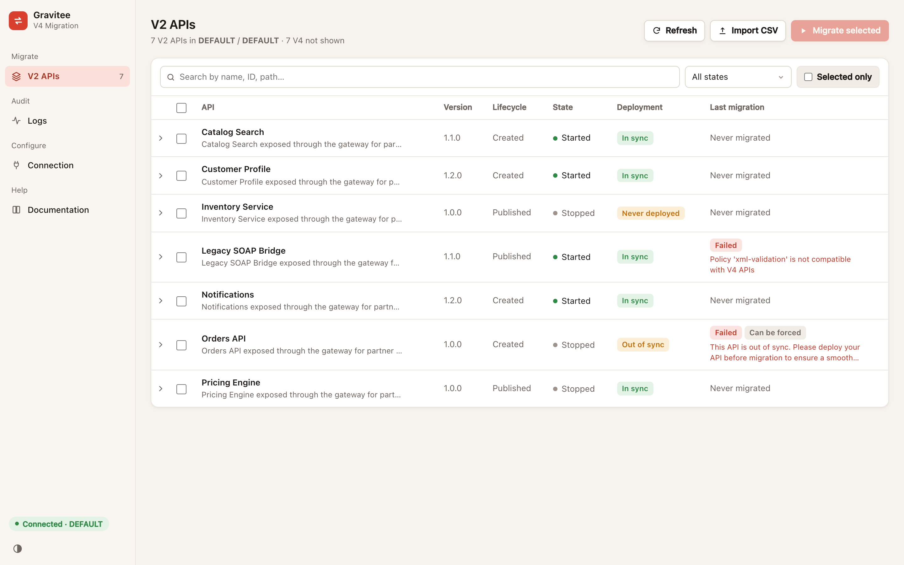
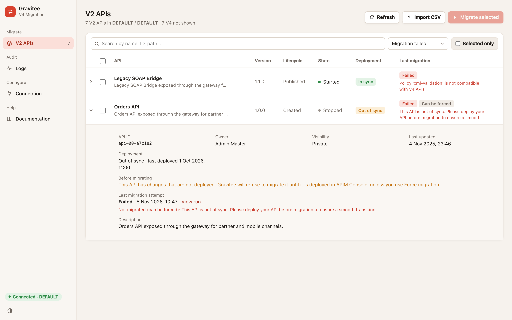
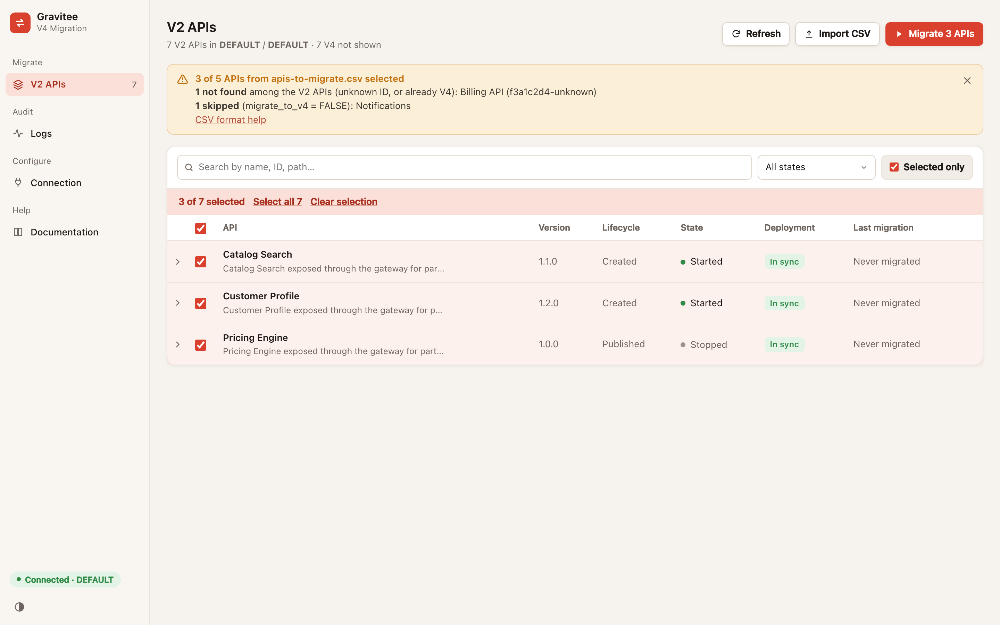
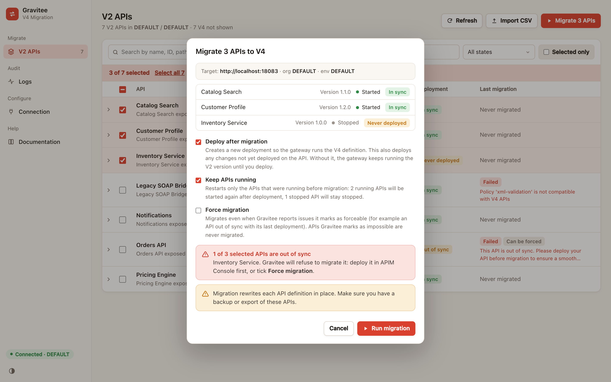
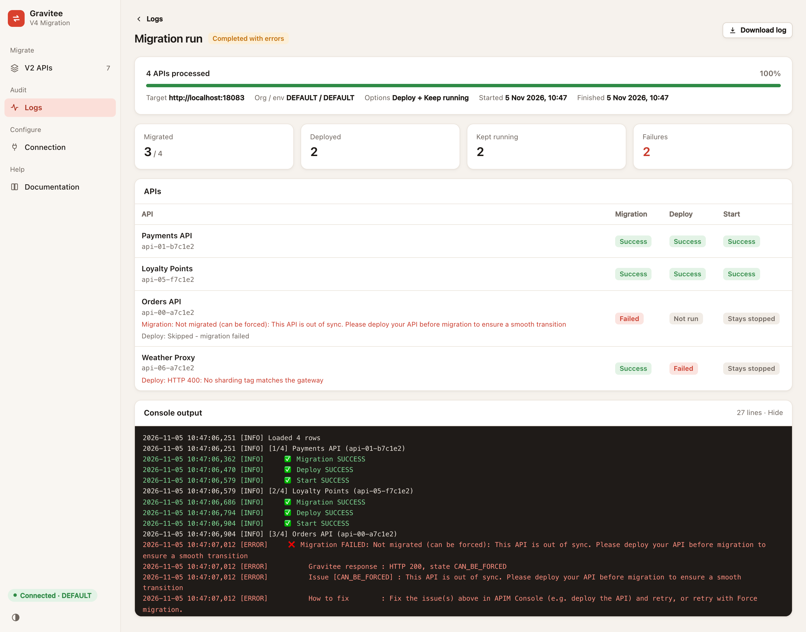
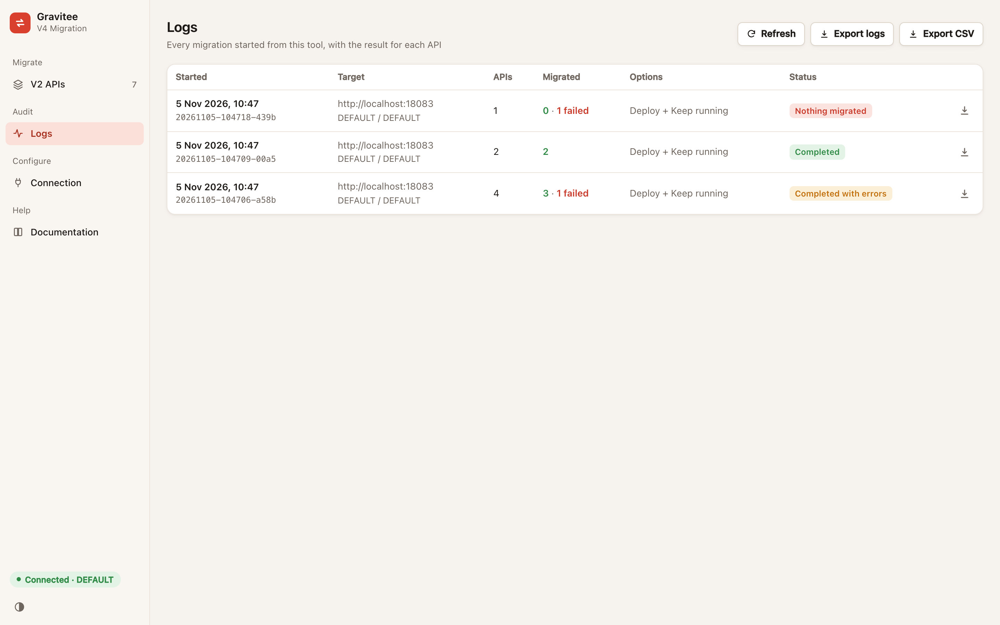
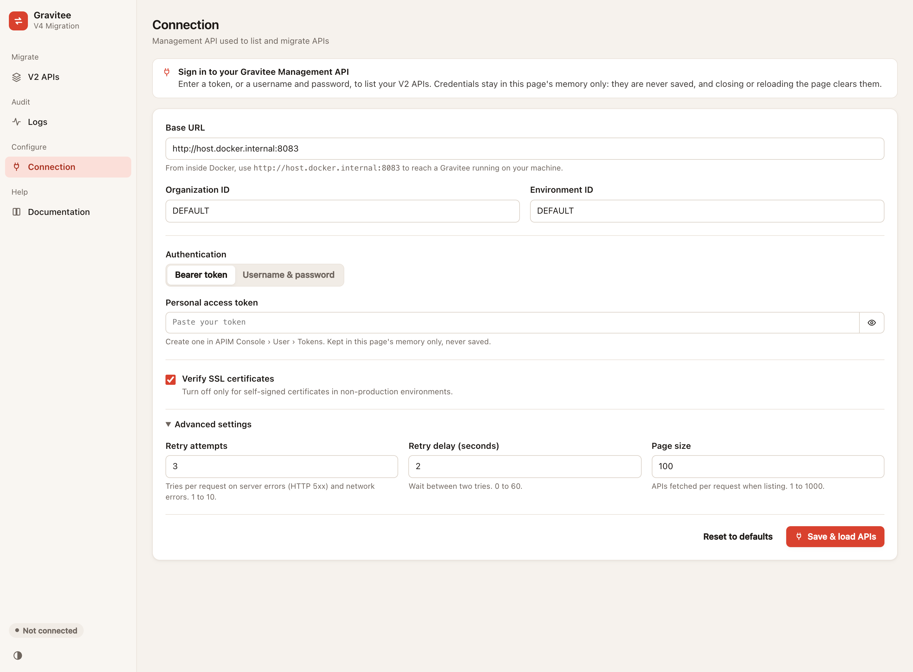
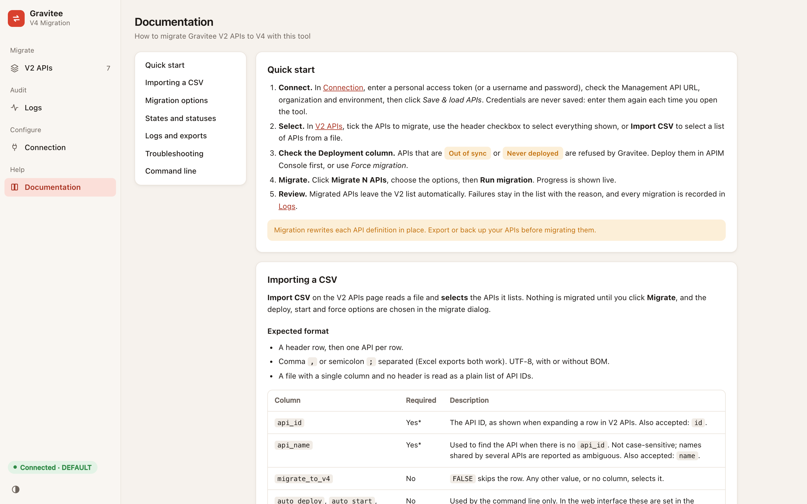
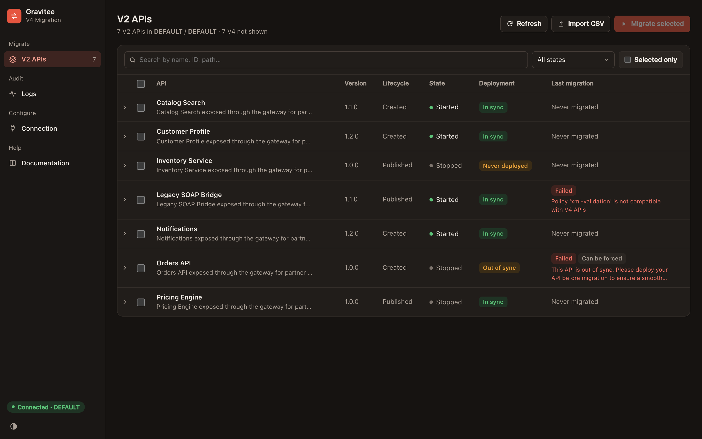

# Gravitee V2 → V4 Migration Tool

A web interface to migrate **Gravitee APIM** APIs from the V2 definition to V4. List your V2 APIs, select the ones to migrate (or import a list from a CSV file), then follow the migration live. Every migration is recorded so you can audit it later.

It runs in a single Docker container, and only uses the Python standard library.

> **Migrating a few APIs?** You can also migrate an API directly from the APIM Console, one API at a time. See the Gravitee documentation: [Migrate APIs](https://documentation.gravitee.io/apim/create-and-configure-apis/create-apis/migrate-apis). This tool uses the same Management API migration endpoint, and adds bulk selection, CSV import, deploy and restart, and an audit trail of every run.



## Features

- **V2 API inventory**: lists every V2 API of an environment, with its state, deployment status and the result of its last migration.
- **Selection**: tick APIs one by one, select everything shown, or **import a CSV file**.
- **Pre-flight checks**: flags APIs that are *out of sync* or *never deployed*, which Gravitee refuses to migrate.
- **Migration options**: deploy after migration, keep running APIs running, force migration.
- **Live progress**: per-API migration, deploy and start status, plus the console output.
- **Reliable results**: an API counts as migrated only once Gravitee confirms it. When Gravitee refuses, the reason is shown in the list and in the logs.
- **Logs**: history of every migration, exportable as one CSV (one row per API) or as one log file.
- **Built-in documentation**, and light and dark themes.
- The original **command-line** workflow still works.

## Requirements

- Docker with Docker Compose v2.
- Gravitee APIM 4.x, with its Management API reachable from the container.
- A Gravitee user allowed to manage the APIs, with a **personal access token** (APIM Console › User › Tokens) or a username and password.

## Quick start

```bash
git clone https://github.com/gravitee-io-labs/gravitee-v2-to-v4-migration-tool.git
cd gravitee-v2-to-v4-migration-tool

docker compose up -d --build ui
```

Open **http://localhost:8080**. To use another port, see [Changing the port](#changing-the-port-env).

The tool opens on the **Connection** page: check the Management API URL, organization and environment, enter your **personal access token** (or a username and password), and click **Save & load APIs**.

Credentials are never stored: they stay in the page's memory and you enter them again each time you open the tool.

To stop the tool:

```bash
docker compose down
```

## Configuration

**All the configuration is done in the web interface, on the Connection page.** The browser remembers your settings, except the credentials, which are never stored.

| Setting | Default | Description |
|---|---|---|
| Base URL | `http://host.docker.internal:8083` | Management API root URL, as seen **from inside the container**. See [Reaching Gravitee](#reaching-gravitee). |
| Organization ID | `DEFAULT` | |
| Environment ID | `DEFAULT` | |
| Authentication | *(none)* | A personal access token (APIM Console › User › Tokens), or a username and password. Required, entered each session, never stored. |
| Verify SSL certificates | On | Turn off only for self-signed certificates outside production. |
| Retry attempts | `3` | *Advanced settings.* Tries per request on server errors (HTTP 5xx) and network errors (1 to 10). |
| Retry delay (seconds) | `2` | *Advanced settings.* Wait between two tries (0 to 60). |
| Page size | `100` | *Advanced settings.* APIs fetched per request when listing (1 to 1000). |

**Reset to defaults** on the Connection page puts back the defaults above.

### Changing the port (`.env`)

The web interface is published on port **8080**, set in the `.env` file at the root of the project:

```
UI_PORT=8080
```

To use another port, edit `UI_PORT` in `.env`, then restart the tool:

```bash
docker compose up -d ui
```

Then open the new address, e.g. `http://localhost:8090` for `UI_PORT=8090`. The port is the only setting in `.env`; never put credentials in it, as it is part of the repository.

### Reaching Gravitee

Inside the container, `localhost` is the container itself, not your machine. Use:

Set the URL in the Connection page:

- **Gravitee running on your machine**: `http://host.docker.internal:8083` (the default). This works on macOS, Windows and Linux; the compose file adds the host mapping Linux needs.
- **Gravitee in another Docker Compose project**: attach the tool to that project's network and use the service name, e.g. `http://gravitee-management-api:8083`. In `docker-compose.yml`, replace the `gravitee_net` network definition with:

  ```yaml
  networks:
    gravitee_net:
      external: true
      name: <gravitee-project>_default   # docker network ls
  ```

- **Remote Gravitee**: the Management API's root URL, e.g. `https://apim-api.example.com`, without `/management`: the tool adds `/management/organizations/...` itself.

## Using the tool

### 1. Review your V2 APIs

The **V2 APIs** page lists every API still on the V2 definition. For each API it shows:

- **State**: Started or Stopped.
- **Deployment**: whether the deployed version matches the API definition.
  - <kbd>In sync</kbd>: ready to migrate.
  - <kbd>Out of sync</kbd> or <kbd>Never deployed</kbd>: Gravitee refuses the migration. Deploy the API in APIM Console first, or use *Force migration*.
- **Last migration**: the result of the last migration attempted from this tool, with Gravitee's reason when it failed.

Use the search box and the filter (Started, Stopped, Out of sync, Migration failed, Never migrated) to narrow the list. Expand a row for its ID, owner, last deployment and the full failure reason.



### 2. Select the APIs to migrate

- Tick APIs one by one, or use the header checkbox to select every API shown.
- Or click **Import CSV** to select the APIs listed in a file (see [CSV import format](#csv-import-format)). A summary lists the rows that were not found, ambiguous or skipped.



### 3. Choose the options and run

Click **Migrate N APIs**. The dialog lists the selected APIs with their version, state and deployment status, and warns you when some are out of sync.



| Option | Default | What it does |
|---|---|---|
| **Deploy after migration** | On | Creates a new deployment so the gateway runs the V4 definition. It also deploys any change not yet deployed on the API. Without it, the gateway keeps running the V2 version until someone deploys the API. |
| **Keep APIs running** | On | Requires Deploy. Starts again the APIs that were running before the migration. Stopped APIs stay stopped. |
| **Force migration** | Off | Migrates even when Gravitee reports issues it marks as forceable, such as an API out of sync. APIs that Gravitee marks as impossible to migrate are never migrated. |

For each API, the steps run in order: migrate, then deploy, then start. A step is skipped when the previous one fails. Only one migration can run at a time.

> [!WARNING]
> Migration rewrites each API definition in place. Export or back up your APIs before migrating them.

### 4. Follow the migration

The migration page shows the progress, the result of each step for each API, the error messages, and the console output.



When the migration ends, the V2 API list refreshes on its own: migrated APIs leave it, and failed ones stay with their reason.

### 5. Audit with the logs

The **Logs** page lists every migration with its target, options and result. Click a row to open it.



| Export | Content | Use it to |
|---|---|---|
| **Export CSV** | One row per API per migration: date, target, options, and the status and error of each step. | Filter or sort in a spreadsheet, keep an audit trail. |
| **Export logs** | Every migration's full log, oldest first, with Gravitee's detailed answers and a "How to fix" hint for failures. | Investigate why something failed. |
| Download icon on a row / **Download log** on a migration's page | The log of a single migration. | |

### Connection

The **Connection** page holds the whole configuration: the URL, organization, environment, SSL option and, under **Advanced settings**, the retry attempts, retry delay and page size (see [Configuration](#configuration)). It is also the only place to enter credentials: a **personal access token**, or a **username and password**. They are kept in the page's memory only: never saved in the browser, never written by the server, and cleared when you close or reload the page. **Clear credentials** removes them from the page right away. The other settings are remembered by your browser; **Reset to defaults** puts back the default values.



### Built-in documentation

**Help › Documentation** covers the same ground as this README inside the tool: quick start, connection settings, CSV format with a downloadable template, migration options, statuses, logs, troubleshooting and command line.



Use the toggle at the bottom of the sidebar to switch between light and dark themes.



## CSV import format

**Import CSV** *selects* the APIs listed in the file. It doesn't migrate anything on its own, and the deploy, start and force options are still chosen in the migrate dialog.

- A header row, then one API per row.
- Comma `,` or semicolon `;` separated, so files saved from Excel work. UTF-8, with or without BOM.
- A file with a single column and no header is read as a plain list of API IDs.

| Column | Required | Description |
|---|---|---|
| `api_id` (or `id`) | Yes\* | The API ID. |
| `api_name` (or `name`) | Yes\* | Used when there is no `api_id`. Not case-sensitive. Names shared by several APIs are reported as ambiguous. |
| `migrate_to_v4` | No | `FALSE` skips the row. |
| `auto_deploy`, `auto_start`, `force_migration` | No | Used by the command line only. |

\* At least one of `api_id` or `api_name`. Other columns are ignored.

```csv
api_id,api_name,migrate_to_v4
5f1a2b3c-4d5e-4f60-8a7b-9c0d1e2f3a4b,Orders API,TRUE
9e8d7c6b-5a49-4382-a1b0-c9d8e7f6a5b4,Payments API,FALSE
```

The file written by the command-line `generate` step is accepted as is. **Help › Documentation** also offers a template pre-filled with your V2 APIs.

## How a migration is checked

For each API, the tool calls the Management API (`/management/v2/organizations/{org}/environments/{env}/apis/{id}/...`):

1. `POST .../_migrate` (with `?mode=FORCE` when *Force migration* is ticked). Gravitee answers HTTP 200 even when it refuses a migration, so the tool reads the answer. The API counts as migrated only if Gravitee returns the state `MIGRATED`, or if the API now reads back as V4. Otherwise the state (`CAN_BE_FORCED`, `IMPOSSIBLE`, …) and each issue are recorded as the failure reason.
2. `POST .../deployments` when *Deploy after migration* is ticked.
3. `POST .../_start` for APIs that were running, when *Keep APIs running* is ticked. "Already started" counts as a success.

The deployment state shown in the list comes from `GET .../apis/{id}` (`deploymentState`, `deployedAt`).

## Command line

The original two-step workflow still works. Each command asks for the Management API URL, organization, environment and SSL option (press Enter to keep the default), then for a personal access token (leave it empty to use a username and password instead), with hidden input:

```bash
docker compose run --rm generate   # writes data/migration_input.csv with every V2 API
# edit data/migration_input.csv: set migrate_to_v4 / auto_deploy / auto_start / force_migration
docker compose run --rm migrate    # migrates the rows with migrate_to_v4=TRUE
```

Results are written to `data/migration_results.csv` and the log to `data/gravitee_migration.log`. The command line uses the default advanced settings: 3 retry attempts, 2 seconds between retries, pages of 100 APIs.

On the command line, `auto_start=TRUE` starts the API whatever its previous state, and `force_migration=TRUE` forces the migration of that row.

## Data and files

Everything the tool writes goes to `./data`, which is mounted at `/data` in the container and ignored by git:

```
data/
└── runs/
    └── <run-id>/          e.g. 20261105-104706-a58b
        ├── meta.json      options, target and results (no credentials)
        ├── input.csv      APIs sent to the migration script
        ├── results.csv    per-API result
        ├── migration.log  log file
        └── console.log    console output
```

To keep the history, back up `data/`. To reset it, stop the tool and delete `data/runs/`.

## Project structure

```
.
├── gravitee_v4_migration.py   migration logic and CLI (generate / migrate)
├── web_app.py                 web server: API listing, runs, exports
├── static/index.html          web interface (single page, no build step)
├── Dockerfile
├── docker-compose.yml         ui service, plus generate / migrate for the CLI
├── .env                       port of the web interface (UI_PORT=8080)
└── docs/screenshots/          images used in this README
```

### Running without Docker

Python 3.10 or later, no dependencies:

```bash
DATA_DIR=./data WEB_PORT=8080 python3 web_app.py
```

Everything is configured in the Connection page, as with Docker. The Base URL is then seen from your machine, so use `http://localhost:8083` for a local Gravitee.

## Security notes

- **No credentials are stored anywhere.** The token, or username and password, are typed in the **Connection** page for each session.
  - **`.env`** only sets the port of the web interface, and is committed with the project. The tool doesn't read it.
  - **Browser**: credentials stay in the page's memory until it is closed or reloaded. Only non-sensitive settings are kept in local storage: URL, organization, environment, authentication mode, SSL option and the advanced settings (retry attempts, retry delay, page size). The token and password fields are not password inputs, so browsers and password managers don't offer to save them.
  - **Server**: credentials arrive with each request and are not kept between requests. They are never written to `data/` or to the logs, and never returned by the API. A migration receives them on its standard input, not in its environment or command line, and the server drops its copy as soon as they are handed over.
  - **Docker**: no credentials in the image, in the container configuration (`docker inspect`) or in its environment.
  - **Command line**: `generate` and `migrate` ask for the token or username/password at start, with hidden input. Credentials in the environment are ignored.
- The web interface has **no login of its own**: anyone who can reach the port can list and migrate APIs with the credentials typed in their own browser, and follow migrations started by others. Keep it on `localhost` or a trusted network. The compose file publishes it on all interfaces; to restrict it to your machine, use `"127.0.0.1:${UI_PORT:-8080}:8080"` under `ports`.
- Between your browser and the tool, the token travels over plain HTTP. That's fine on `localhost`; to reach the tool from another machine, put it behind HTTPS.

## Troubleshooting

| Symptom | Fix |
|---|---|
| `HTTP 401 Unauthorized` | The token is invalid or expired. Create a new one in APIM Console › User › Tokens, then paste it in **Connection**. |
| Back on the Connection page after a reload | Expected: credentials are never stored. Enter them again. |
| Cannot connect / connection refused | The Base URL in Connection must be reachable from the container. See [Reaching Gravitee](#reaching-gravitee). |
| `HTTP 404` when listing APIs | Check the organization and environment IDs, and that the base URL doesn't include `/management`. |
| *"This API is out of sync. Please deploy your API before migration"* | Deploy the API in APIM Console, click **Refresh**, then migrate again, or tick **Force migration**. |
| SSL certificate errors | For self-signed certificates outside production, untick **Verify SSL certificates** in Connection. |
| Server errors (HTTP 5xx) or timeouts from a slow Gravitee | Raise **Retry attempts** and **Retry delay** in Connection › Advanced settings. With many APIs, a smaller **Page size** makes each listing request lighter. |
| A migration shows *Interrupted* | The container stopped during the migration. Check the APIs in APIM Console, then migrate the remaining ones again. |
| Port 8080 already in use | Edit `UI_PORT` in `.env`, e.g. `UI_PORT=8090`, then run `docker compose up -d ui` (see [Changing the port](#changing-the-port-env)). |

To see the server output:

```bash
docker compose logs -f ui
```
